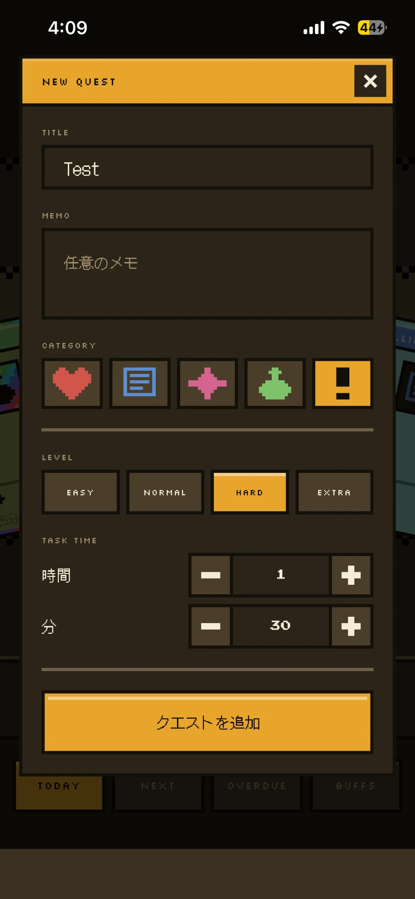
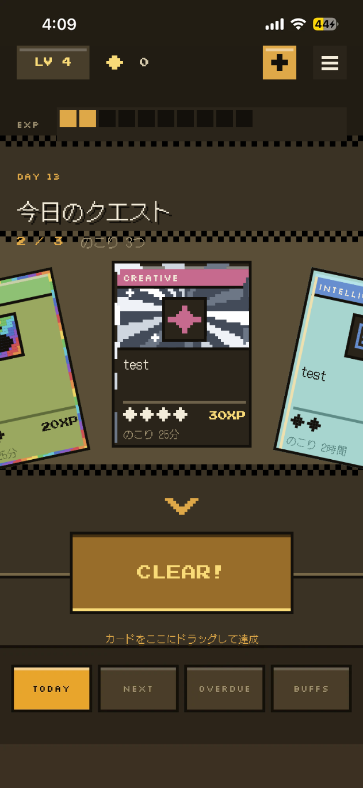
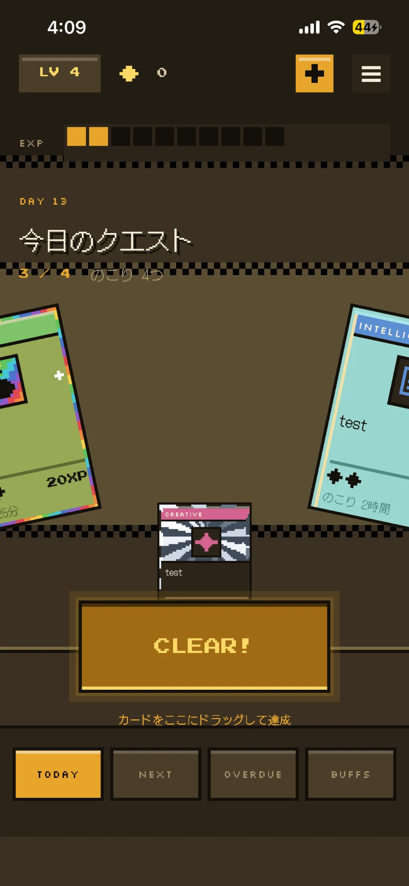
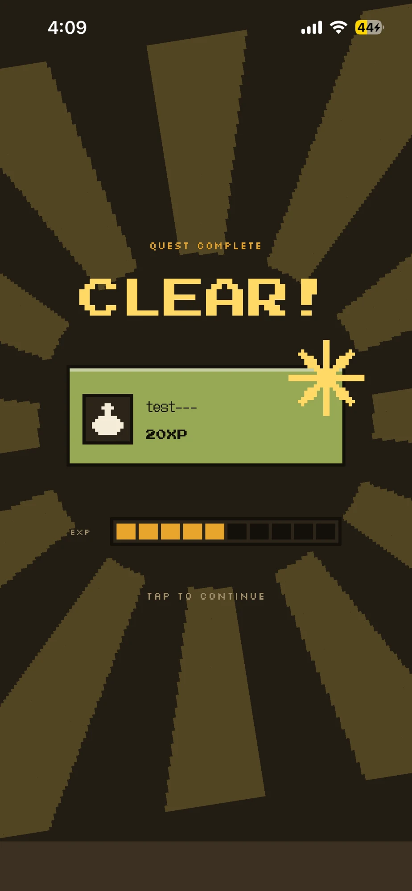
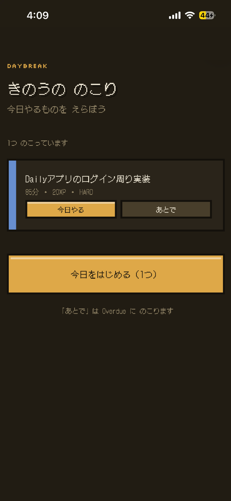
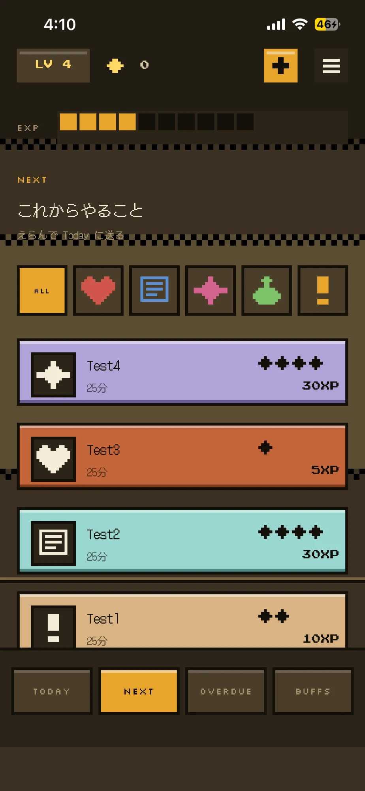
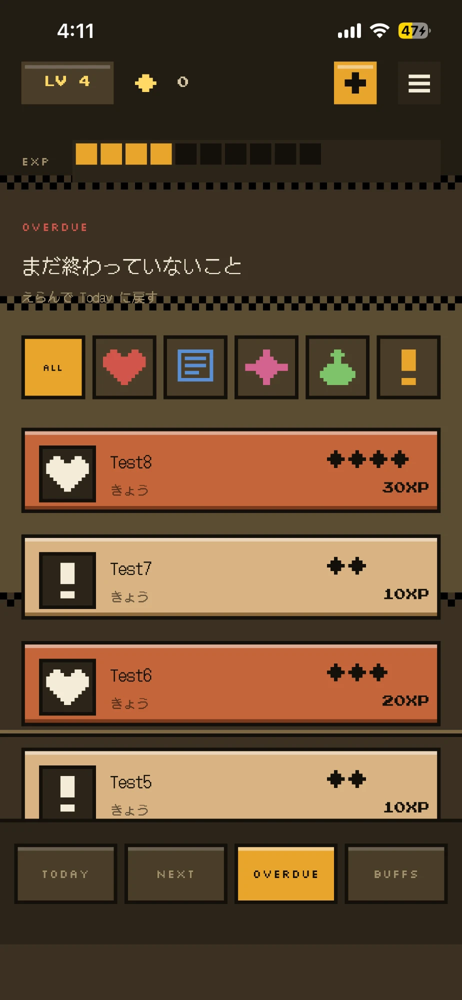
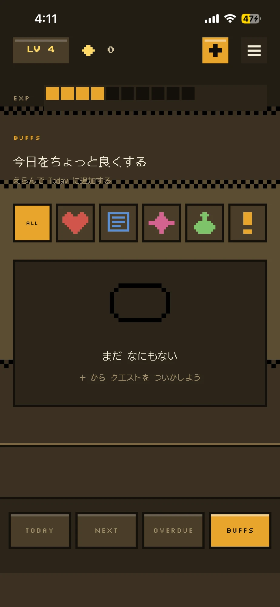

# daily-app

日々のタスクを RPG のクエストとして扱い、達成するとアプリの中の自分（アバター）が育つ、ピクセルゲーム調の Todo アプリ。
スマートフォンでの利用を主とした PWA です。

> **開発中です。** 外部への公開は、React Native で作っているネイティブ版 [daily-app-native](https://github.com/tuzuya/daily-app-native) で行う予定です（[開発の進め方](#開発の進め方ネイティブ版との関係)）。

## 概要

ふつうの Todo アプリでは「タスクを終わらせたいから」タスクをこなしますが、このアプリでは動機を「アバターを育てたいから」に置き換えています。
タスクのカテゴリは RPG のステータス（Vitality / Intelligence / Creative / Recovery / Quest）に対応していて、達成したタスクの XP がそのままアバターの成長になります。

UI はピクセルアートで統一しています。以前はぼかしやグラデーションを多用したデザインでしたが、iPhone（iOS Safari）で描画が重くなり落ちる問題が続いたため、描画負荷が構造的に軽いピクセル調に作り直しました。

## 使い方の流れ

iPhone で実際に操作した画面です。上の段が1日の流れ、下の段が翌日以降に使う画面です。

<table>
  <tr>
    <th>1. クエストを作る</th>
    <th>2. 今日のクエスト</th>
    <th>3. ドラッグで達成</th>
    <th>4. クリア</th>
  </tr>
  <tr>
    <td></td>
    <td></td>
    <td></td>
    <td></td>
  </tr>
  <tr>
    <td>タイトル・カテゴリ・難易度・所要時間を決める。難易度で獲得 XP が変わる</td>
    <td>今日のタスクがカードのカルーセルで並ぶ。左右にめくって選ぶ</td>
    <td>カードを「CLEAR!」へ下にドラッグすると達成</td>
    <td>演出が出て XP がたまり、レベルが上がる</td>
  </tr>
  <tr>
    <th>5. 翌朝の仕分け</th>
    <th>6. Next</th>
    <th>7. Overdue</th>
    <th>8. Buffs</th>
  </tr>
  <tr>
    <td></td>
    <td></td>
    <td></td>
    <td></td>
  </tr>
  <tr>
    <td>きのう終わらなかったタスクを「今日やる / あとで」に振り分けて1日を始める</td>
    <td>今後やるタスクの一覧。カテゴリで絞り込み、選んで Today へ送る</td>
    <td>期限内に終わらなかったタスクの一覧。選んで Today へ戻す</td>
    <td>生活を少し良くする小さなタスクの一覧（機能は実装中）</td>
  </tr>
</table>

## 設計の考え方

このアプリは「Todo アプリの見た目をした育成ゲーム」として設計しています。
タスクはそれ自体が目的ではなく、アバターを育てるための手段です。画面や操作を足すときは、それが育成の動機につながるかを判断基準にしています。

- **カテゴリ ＝ アバターのステータス**: 5つのカテゴリは、タスクの分類であると同時に、育てる対象のステータスそのもの
- **難易度 ＝ 育つ速さ**: 難しいタスクほど獲得 XP が多く、カードの見た目も豪華になる
- **成長が常に見える**: LV と EXP は、どのタブの画面でも上部に表示する
- **達成を「操作」にする**: チェックボックスではなく、カードを「CLEAR!」へドラッグして達成し、クリア演出で区切りをつける
- **サボっても育成は消えない**: 前日に残ったタスクは翌朝に「今日やる / あとで」を選び直すだけで、ペナルティは与えない

アバターの見た目の成長、コインの使い道、Buffs の提案機能はまだ実装していません。

## 開発の進め方（ネイティブ版との関係）

このリポジトリ（Web 版）と [daily-app-native](https://github.com/tuzuya/daily-app-native)（React Native 版）は、同じアプリを役割を分けて開発しています。

1. **Web 版（このリポジトリ）で改善案を実装して確かめる**: PWA なので、デプロイすればすぐスマホで実際の操作感を確認できる
2. **採用した改善をネイティブ版に実装する**: React Native の学習も兼ねて、Web 版で固まった仕様を移していく
3. **外部への公開はネイティブ版で行う**: Web 版は試作と検証の場として使い続ける

## 主な機能

| 画面 | 内容 |
|---|---|
| Today | 今日のタスクをカードのカルーセルで表示。カードを下にドラッグすると達成になり、演出が出る |
| Next | 今日ではないが、今後やるタスクの一覧 |
| Overdue | 期限内に達成できなかったタスクの一覧 |
| Buffs | 生活の質を上げる小さなタスクの一覧（AI による提案は構想段階） |
| Profile | カテゴリ別の XP をアバターのステータスとして表示 |
| 日をまたいだときの仕分け | 前日以前の Today に残ったタスクを「今日へ持ち越す / Overdue へ送る」に振り分ける |

- タスクの作成・編集。Next / Overdue / Buffs の一覧から、タスクを今日へ移せる
- ホーム画面に追加すると、アドレスバーのないアプリとして起動（PWA）

ログイン機能は未実装です。現在は公開環境全体を Basic 認証で保護しています。

## 技術構成

| 領域 | 技術 |
|---|---|
| フロントエンド | Next.js（App Router）、React、TypeScript、Tailwind CSS、Framer Motion |
| API | Next.js Route Handlers（`src/app/api/`） |
| DB | Neon（PostgreSQL）、Drizzle ORM |
| ホスティング | Vercel（関数のリージョンは DB と同じシンガポール） |

```
ブラウザ（PWA）
  └─ Next.js（Vercel）
       ├─ src/app/*        画面
       ├─ src/app/api/*    Route Handlers（タスクの CRUD・日をまたいだときの仕分け）
       └─ src/proxy.ts     Basic 認証（認証の本実装までの暫定）
            └─ Drizzle ORM ─▶ Neon（PostgreSQL）
```

- 日付はサーバーではなく、利用者の端末のローカル日付を基準にしています（サーバーとタイムゾーンがずれても「今日」が狂わないようにするため）
- 当初は Supabase を使っていましたが、認証やストレージの機能を使っておらず、無料プランでは無操作が1週間続くと休止するため、Neon に移行しました

## ディレクトリ構成

```
src/app/          画面（today / next / overdue / buffs / profile）と API
src/app/components/  カルーセル・カード・演出などの UI 部品
src/proxy.ts      Basic 認証
lib/              DB 接続・スキーマ、データ取得のフック、日付処理、ピクセル描画
docs/             設計ドキュメント（下記）
```

## 開発環境の構築

前提: Node.js 20 以上、Neon などの PostgreSQL

```bash
npm install
cp .env.example .env.local   # DATABASE_URL を設定する
npm run db:push              # Drizzle のスキーマを DB に反映
npm run dev                  # http://localhost:3000
```

| 環境変数 | 用途 |
|---|---|
| `DATABASE_URL` | Neon の pooled 接続文字列（ホスト名に `-pooler` が入っているもの） |
| `BASIC_AUTH_USER` / `BASIC_AUTH_PASSWORD` | 本番の Basic 認証。本番で未設定だと全リクエストが 503 になる。`npm run dev` では不要 |
| `NEXT_PUBLIC_SITE_URL` | 公開 URL（任意） |

```bash
npm run lint
npm run build
```

## 設計ドキュメント

| ファイル | 内容 |
|---|---|
| [`docs/ai-product-brief.md`](docs/ai-product-brief.md) | プロダクト仕様・要件・ロードマップ（何を作るか） |
| [`docs/ai-dev-guide.md`](docs/ai-dev-guide.md) | 技術スタック・アーキテクチャ・コーディングルール（どう作るか） |
| [`docs/pixel-style-guide.md`](docs/pixel-style-guide.md) | ピクセルスタイルの寸法・色・書体・モーション |
| [`docs/backend-implementation-plan.md`](docs/backend-implementation-plan.md) | API・DB の構成と、技術選定の経緯 |
| [`docs/ai-error-log.md`](docs/ai-error-log.md) | 不具合の記録（主に iOS Safari） |
